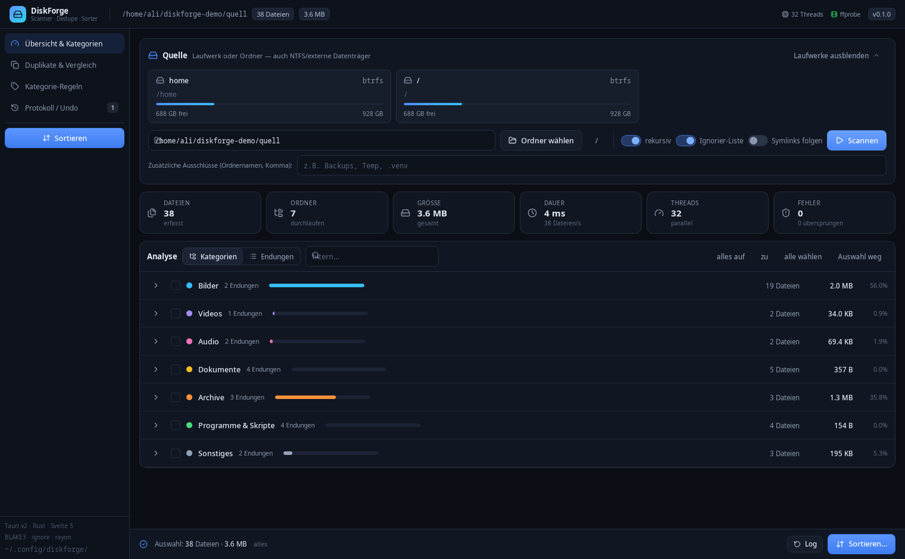
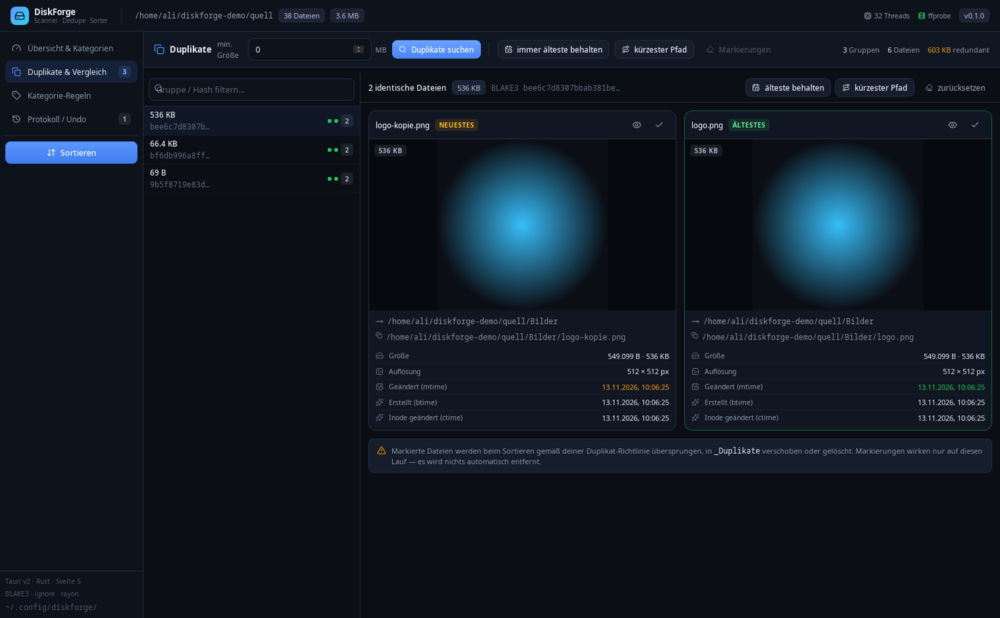
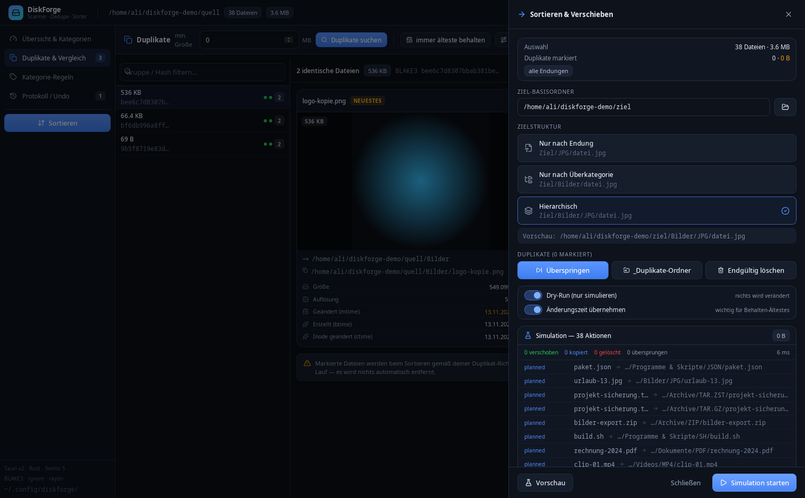
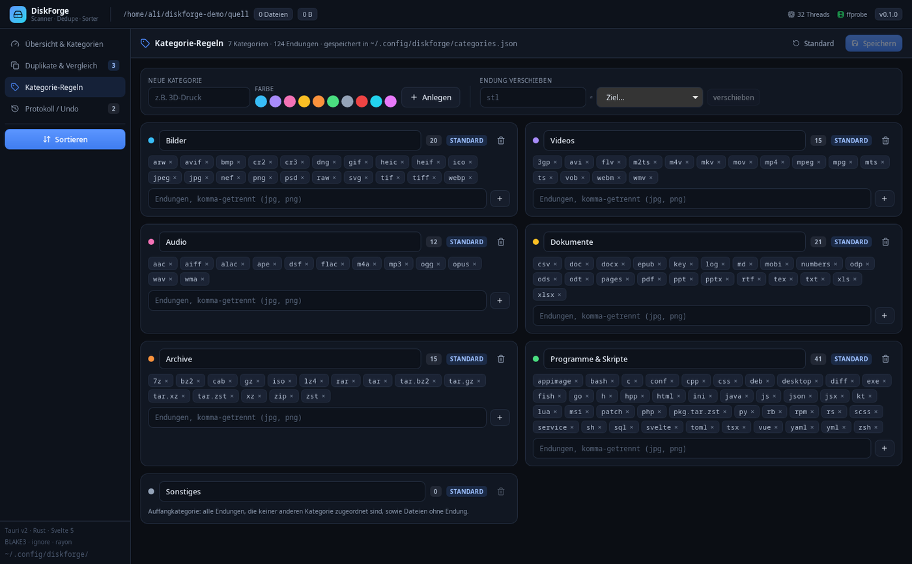
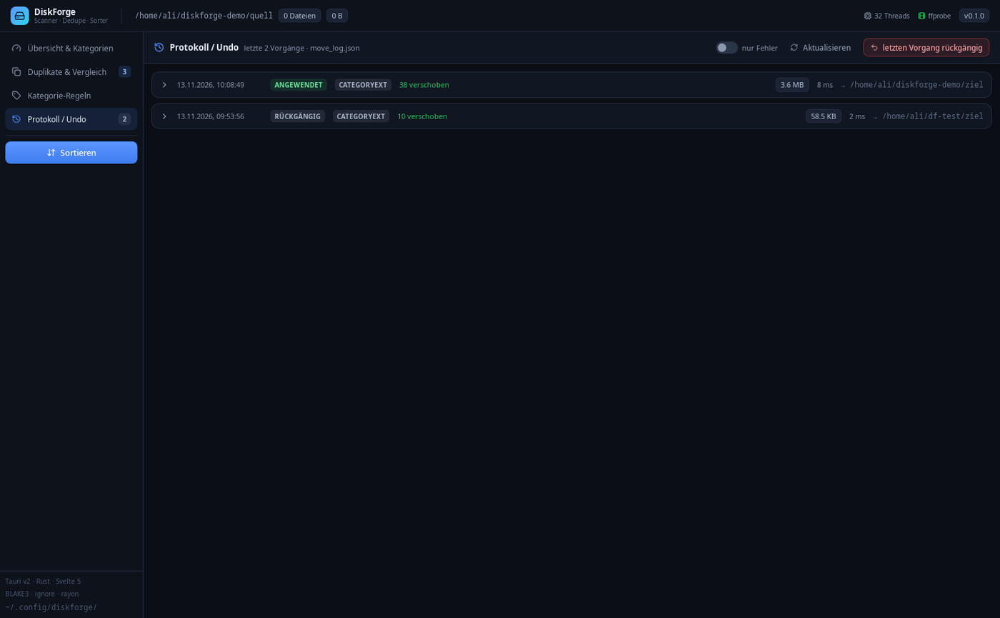

<div align="center">



# DiskForge

**Festplatten scannen. Duplikate finden. Aufräumen — in Sekunden.**

Schneller Disk-Analyzer, Duplikatfinder und Dateisortierer für Linux (CachyOS/Arch, KDE),
gebaut mit **Tauri 2, Rust und Svelte 5**.

[](https://www.rust-lang.org/)
[](https://tauri.app/)
[](https://svelte.dev/)
[](LICENSE)
[](#roadmap)

</div>

---

## Was macht DiskForge?

DiskForge ist für den unangenehmen Teil der Datenpflege gebaut: eine externe
NTFS-Platte mit 2,6 TB, 78.000 Dateien und jede Menge Duplikate. Statt Dateimanager
und Shell-Skripten gibt es eine einzige Oberfläche, die in Sekunden weiß, was auf
der Platte liegt — und die aufräumen kann, ohne Daten zu riskieren.

| | |
|---|---|
| ⚡ **Schnell** | 78.000 Dateien / 894 GB in **3,4 s** (kalter Cache, USB-HDD), 32 Threads parallel |
| 🧬 **Duplikate per Inhalt** | Gruppierung nach Größe, dann BLAKE3-Hash — Teil-Hash bei großen Dateien |
| 🖼️ **Side-by-Side** | Bilder und Videos nebeneinander, mit Auflösung, Dauer, mtime/btime/ctime |
| 📂 **Sortieren mit Vorschau** | Endung, Überkategorie oder hierarchisch — Dry-Run zeigt jeden Zielpfad |
| ↩️ **Undo** | Jeder Sortiervorgang ist protokolliert und komplett rückgängig zu machen |
| 🇩🇪 **Deutsch** | Oberfläche, Fehlermeldungen und Doku auf Deutsch |

## Funktionen im Detail

### Scannen & Analysieren
- Paralleler Verzeichnisdurchlauf über alle Kerne (`ignore`-Walker, thread-lokale Puffer).
- Live-Fortschritt über Tauri-Events: Dateien, Ordner, Bytes, Dateien/s, aktueller Pfad.
- Sofort abbrechbar (`AtomicBool`), Ergebnisse bleiben konsistent.
- Erkennung von Laufwerken unter `/run/media`, `/media`, `/mnt` inkl. Kennzeichnung
  **schreibbar / read-only** und Belegung; btrfs-Subvolumes werden zusammengefasst.
- Ignorier-Liste für `$RECYCLE.BIN`, `System Volume Information`, `.Trash-*`, `.git`,
  `node_modules`, `lost+found` u. a. — pro Scan abschaltbar, eigene Ausschlüsse ergänzbar.
- Endungen case-insensitiv zusammengefasst (`.JPG` = `jpg`), Dateien ohne Endung separat.
- Compound-Endungen (`pkg.tar.zst`, `tar.gz`, `tar.xz`, …) bleiben erhalten.
- Umschaltbare Ansicht: **Kategorien** (aufklappbar) oder **flache Endungsliste**.

### Kategorien
Sieben Standardkategorien mit ~124 Endungen, im UI frei editierbar:

`Bilder` · `Videos` · `Audio` · `Dokumente` · `Archive` · `Programme & Skripte` · `Sonstiges`

- Eigene Kategorien anlegen (Name + Farbe), Endungen per Chip hinzufügen/entfernen.
- Endungen zwischen Kategorien verschieben; Konflikte werden erkannt und markiert.
- Gespeichert in `~/.config/diskforge/categories.json`, „Standard" stellt alles zurück.

### Duplikate
1. **Stufe 1:** Gruppierung nach exakter Byte-Größe.
2. **Stufe 2:** BLAKE3 über `rayon` — bei Dateien > 50 MB zuerst ein Teil-Hash der
   ersten und letzten 64 KB, nur bei Gleichheit der Voll-Hash.

Vergleichsansicht pro Gruppe:
- Bild-Vorschau in Originalauflösung (Zoom/Vollbild), Video im HTML5-Player.
- Metadaten je Datei: vollständiger Pfad, Bytes + KB/MB, **Auflösung** (`3840 × 2160 px`),
  Videodauer/Bitrate, **mtime, btime, ctime** — älteste und neueste Version farbig markiert.
- Einzelne Dateien zum Aussortieren markieren, Bulk-Helfer „immer älteste behalten"
  und „kürzester Pfad behalten".

### Sortieren
- Zielbasis frei wählbar, drei Strukturen:

  | Modus | Ergebnis |
  |---|---|
  | Nur Endung | `Ziel/JPG/foto.jpg` |
  | Nur Überkategorie | `Ziel/Bilder/foto.jpg` |
  | Hierarchisch | `Ziel/Bilder/JPG/foto.jpg` |

- **Dry-Run** zeigt vorab jede geplante Aktion samt Zielpfad.
- Namenskonflikte werden nie überschrieben: `foto.jpg` → `foto (1).jpg` → `foto (2).jpg`.
- **Cross-Device/NTFS:** schlägt `rename` mit `EXDEV` fehl, wird kopiert, per BLAKE3
  verifiziert und erst dann die Quelle gelöscht. mtime bleibt erhalten.
- Ungültige NTFS-Zeichen und reservierte Namen (`CON`, `NUL`, `COM1`, …) werden abgefangen;
  `PermissionDenied` wird gesammelt statt den Lauf abzubrechen.
- Duplikat-Richtlinie: **überspringen**, in `_Duplikate/` verschieben oder endgültig löschen
  (mit Sicherheitsabfrage).

### Protokoll & Undo
Jeder Lauf landet in `~/.config/diskforge/move_log.json` (max. 30 Batches) mit
Quelle, Ziel, Aktion, Bytes und Fehlern. Der letzte Vorgang lässt sich vollständig
rückgängig machen — inklusive Wiederherstellung der Ordnerstruktur.

## Installation

### Fertiges Paket (empfohlen)
```bash
git clone https://github.com/OWNER/diskforge.git
cd diskforge
./install-desktop.sh          # nach dem Build, siehe unten
```

### Aus dem Quellcode bauen

**Systempakete (Arch/CachyOS):**
```bash
sudo pacman -S --needed base-devel curl wget file openssl \
  webkit2gtk-4.1 libappindicator-gtk3 librsvg appmenu-gtk-module \
  ntfs-3g nodejs npm rust
# optional für Video-Metadaten:
sudo pacman -S --needed ffmpeg
```

**Bauen und starten:**
```bash
npm install
npm run tauri dev            # Entwicklungsmodus mit Hot-Reload

npm run tauri build -- --no-bundle
./install-desktop.sh         # installiert nach ~/.local/{bin,share}, Menüeintrag inklusive
```

Das Release-Binary liegt danach unter `src-tauri/target/release/diskforge` (ca. 7 MB).

**Deinstallieren:**
```bash
rm ~/.local/bin/diskforge ~/.local/share/applications/diskforge.desktop
rm ~/.local/share/icons/hicolor/*/apps/diskforge.*
kbuildsycoca6
```

## Bedienung in 60 Sekunden

1. **Laufwerk wählen** (Karte oben) oder Pfad eintippen → **Scannen**.
2. In der Analyse Kategorien aufklappen, Endungen anhaken (Standard: alles).
3. **Duplikate & Vergleich** → Mindestgröße setzen → **Duplikate suchen** →
   Gruppe anklicken, Dateien vergleichen, „älteste behalten".
4. **Sortieren** → Zielordner, Struktur, Duplikat-Richtlinie →
   **Simulation starten**, prüfen, dann **Jetzt sortieren**.
5. Bei Bedarf **Protokoll / Undo** → *letzten Vorgang rückgängig*.

## Architektur

```
src/                       Svelte-5-Frontend (Runes, Tailwind 4)
  App.svelte               Layout, Sidebar, Toasts
  lib/store.svelte.js      zentraler Store + Tauri-IPC
  lib/tabs/                Overview · Duplicates · Rules · LogTab
  lib/components/          VirtualList · CategoryTree · DupCard · SortDrawer …
src-tauri/src/             Rust-Backend
  scanner.rs               paralleler Walker, Kategorisierung, Fortschritts-Events
  hasher.rs                zweistufige Duplikaterkennung (BLAKE3 + rayon)
  metadata.rs              Bild-/Video-/Audio-Metadaten (imagesize, mp4parse, ffprobe)
  mover.rs                 Sortieren, Namenskonflikte, EXDEV-Fallback, Log, Undo
  categories.rs            Kategorie-Regeln (categories.json)
  mounts.rs                Laufwerke aus /proc/self/mounts + statvfs
  commands.rs              Tauri-Commands, AppState, Event-Emitter
```

Mehr dazu in [`docs/ARCHITECTURE.md`](docs/ARCHITECTURE.md).

**Tauri-Commands:** `list_mounts`, `system_info`, `get_categories`, `save_categories`,
`reset_categories`, `pick_directory`, `start_scan`, `cancel_task`, `get_summary`,
`find_duplicates`, `get_duplicates`, `file_meta`, `plan_sort`, `execute_sort`,
`get_log`, `undo_last`, `undo_batch`, `reveal_path`.

**Events:** `df://progress`, `df://scan-done`, `df://dups-done`, `df://sort-done`.

## Tests

```bash
cd src-tauri && cargo test      # 23 Unit-Tests: Scanner, Hasher, Mover, Kategorien, Mounts
npm run check                   # svelte-check
```

## Screenshots

| Duplikat-Vergleich | Sortieren mit Dry-Run |
|---|---|
|  |  |

| Kategorie-Regeln | Protokoll & Undo |
|---|---|
|  |  |

Demo-Daten für eigene Screenshots: `./scripts/make-demo-data.sh` (erzeugt
`~/diskforge-demo` mit Bildern, Videos, Audio, Archiven und echten Duplikaten).

## Roadmap

- [ ] Sortieren nach Aufnahmedatum (EXIF) und Dateinamen-Schema
- [ ] Ähnliche Bilder finden (perzeptueller Hash) zusätzlich zu exakten Duplikaten
- [ ] Paralleler Export als CSV/JSON-Bericht
- [ ] Windows- und macOS-Builds
- [ ] Übersetzungen (EN/TR) über i18n
- [x] Menü-Integration (`.desktop`, Icons, `kbuildsycoca6`)

## Mitmachen

Beiträge sind willkommen — ob Bugreport, Idee oder Pull Request.
Lies vorher [`CONTRIBUTING.md`](CONTRIBUTING.md) und den
[Verhaltenskodex](CODE_OF_CONDUCT.md).

Gute Einstiegspunkte sind Issues mit den Labels `good first issue` und `help wanted`.

## Lizenz

[MIT](LICENSE) © Ali Utlu

## Danksagung

Gebaut mit [Tauri](https://tauri.app), [Svelte](https://svelte.dev),
[Tailwind CSS](https://tailwindcss.com), [ignore](https://github.com/BurntSushi/ripgrep/tree/master/crates/ignore),
[rayon](https://github.com/rayon-rs/rayon), [blake3](https://github.com/BLAKE3-team/BLAKE3),
[imagesize](https://github.com/Roughsketch/imagesize), [mp4parse](https://github.com/mozilla/mp4parse-rust)
und [lucide](https://lucide.dev).
